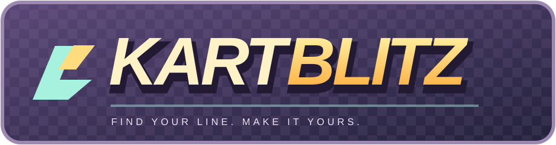
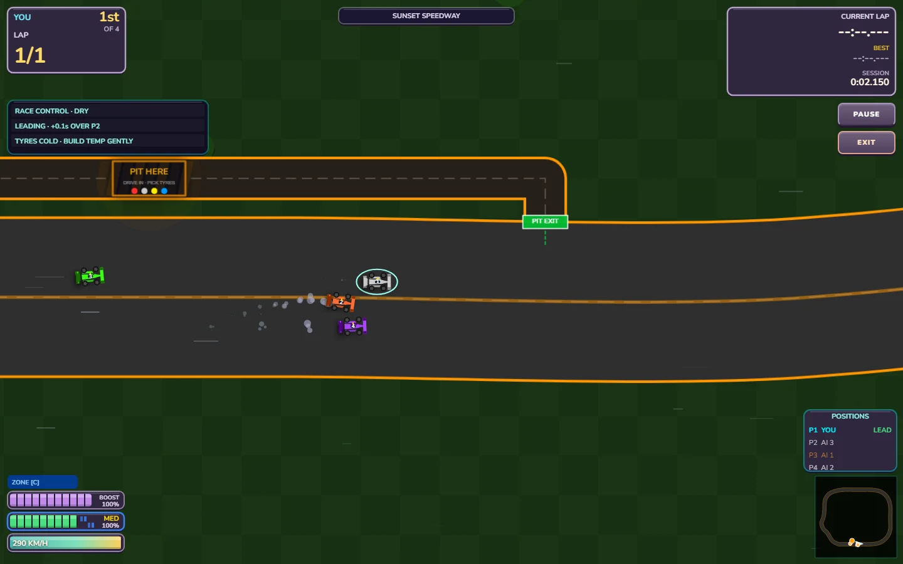
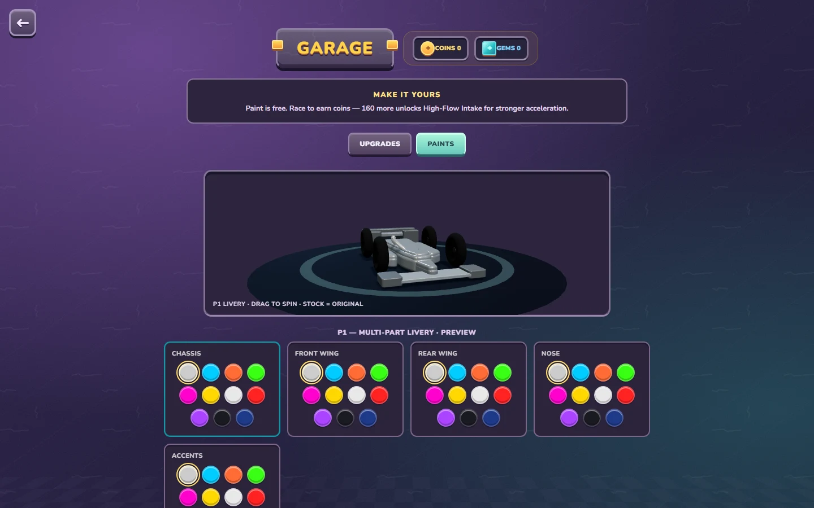
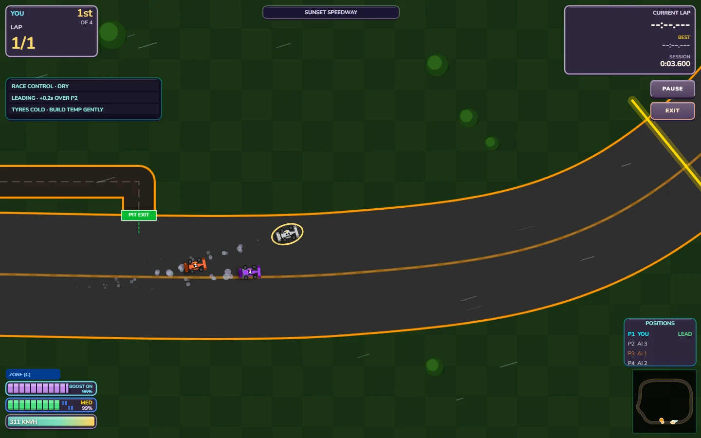
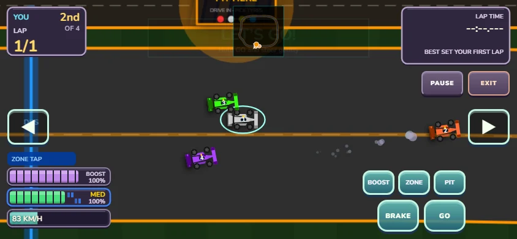
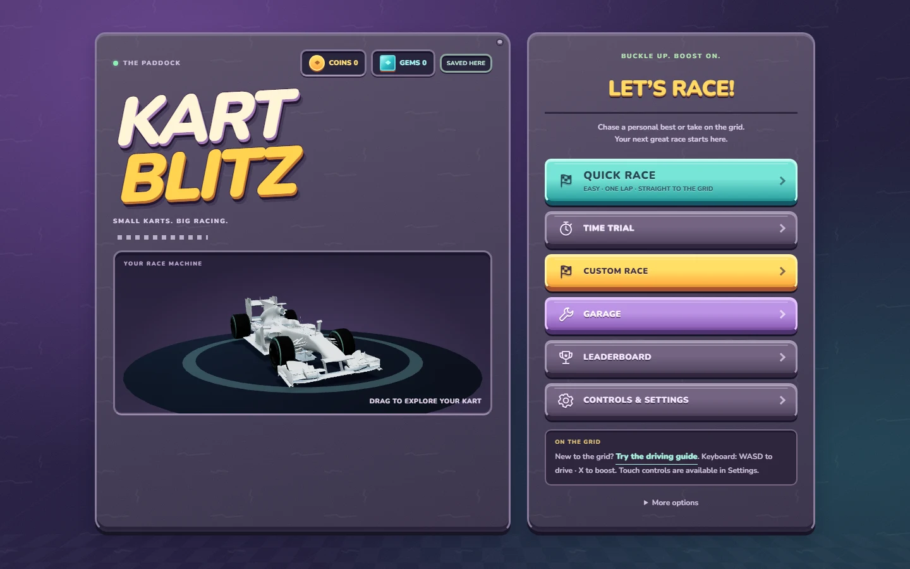

<p align="center">
  
</p>

<p align="center"><strong>Small karts. Big racing.</strong><br>
A browser kart racer for a quick race, a friendly rivalry, or one more lap chasing your best time.</p>

<p align="center"><a href="https://leaferd6712.github.io/KartBlitz/"><strong>PLAY KARTBLITZ →</strong></a><br><sub>Free to play in your browser · Keyboard or touch · No installation</sub></p>

[](https://leaferd6712.github.io/KartBlitz/)

## Play KartBlitz

### In your browser · Available now

**[Launch the game →](https://leaferd6712.github.io/KartBlitz/)**

Choose **Quick Race** for an easy, one-lap race with three opponents. New to the track? Try the driving guide from the welcome screen or main menu. Local racing needs no account; online rooms and cloud leaderboards need an internet connection.

### Windows portable · Built, awaiting a public release

A standalone **64-bit Windows executable** can be built from this repository. Run it without an installer; the game and its browser engine are included, so solo and local modes work offline. Progress is saved separately for your Windows user.

**[Check GitHub Releases](https://github.com/Leaferd6712/KartBlitz/releases)** · [Build it yourself](docs/desktop.md)

There is no published Windows download yet. The release page will carry the portable `.exe` and its checksum when a build is published. Current builds are unsigned.

**Windows installer · Deferred.** The portable executable already covers playing on a personal PC. A separate installer would add Start menu shortcuts and uninstall support, rather than a different game. One desktop format keeps downloads and updates simpler for now.

## Find your kind of race

- **Straight onto the grid.** Quick Race picks beginner-friendly conditions. Custom Race lets you choose AI difficulty, laps, weather, tyres and setup.
- **One more lap.** Time Trial is an open practice session with personal bests, medals and a local personal-best ghost. Leave whenever you are ready.
- **Bring a rival.** Share a keyboard in two-player split-screen, take on a one-lap AI shootout, or join an online lobby for up to six racers when the online service is reachable.
- **Learn the circuit.** Eight built-in circuits offer different layouts, surfaces and scenery. Earn rewards and unlock more tracks as you improve.
- **Make the kart yours.** Start with white, then unlock colours with race coins and paint individual parts. Earn coins through racing to research and fit performance upgrades; competitive Time Trial and online racing use equalised performance.
- **A little extra pace.** Switch Boost on for straights and use the blue speed zones. The HUD shows charge, tyre condition and your position; distinct sounds mark ability activation and readiness.



## On the track



**Keyboard:** W / S accelerate and brake, A / D steer, X Boost, C speed zone, P pit. Esc pauses. Keys can be changed in **Controls & Settings**.

**Touch:** steer with ◀ / ▶ and use the GO / BRAKE pedals. Boost, Zone and Pit have separate buttons. Landscape gives the track more room.



<details>
<summary><strong>The paddock</strong></summary>



Screenshots above are captures from this branch's running game. The hosted version updates after changes reach the deployment branch.

</details>

## Tools & feature directory

Open these tools directly from here. The player menus contain racing, garage, leaderboards, controls and news. Browser launch links use the hosted website; they pick up these changes after deployment. For a local checkout, serve this folder and use the same paths under `http://localhost:8000/`.

### ML Lab & training

- **[Open ML Lab](https://leaferd6712.github.io/KartBlitz/index.html?tool=ml)** — lessons, reward experiments, training configuration, checkpoint replays, model import/export and model races. No menu opt-in is needed. Leaving a lab race returns to the lab; Back opens the normal game.
- **Verified leaderboard examples** — in ML Lab → Build, choose a demonstration circuit and **Load verified laps**, then **Use for ML**. Record your own clean lap and export demonstrations from the same panel. Normal leaderboards retain **Race Ghost**.
- **[Python trainer and setup](ml_training/README.md)** · [downloadable setup guide](ml_training/KartBlitz-ML-Setup.txt) — install/start commands, pairing, command-line training and model validation. The trainer ZIP is available inside ML Lab → Train.
- **[Legacy Node AI experiment](docs/tools.md#legacy-node-ai-trainer)** — the older headless reinforcement-learning script and saved policy, separate from the current Python trainer.

### Admin & editors

- **[Open Admin Station](https://leaferd6712.github.io/KartBlitz/leaderboard-admin.html)** — password-protected editing of Time Trial/Versus lap times, online wins and player entries; deletion and random test entries.
- **[Open Track Editor](https://leaferd6712.github.io/KartBlitz/index.html?admin=track)** — password-protected track creation, layouts, AI lines, checkpoints, pits, speed zones, target lap times and import/export. Also available from Admin Station.
- **[Open Patch Notes Editor](https://leaferd6712.github.io/KartBlitz/patch-notes-editor.html)** — edit, preview and export patch notes after admin login. Players can still read **What's new** in the game.
- **[Legacy standalone Track Editor](https://leaferd6712.github.io/KartBlitz/Old%20Track%20Editor/track-editor.html)** · [legacy editor guide](Old%20Track%20Editor/TRACK-EDITOR.md) — retained for older projects; exports must be applied manually.

### Records, diagnostics & technical guides

- **[Leaderboard backups and exports](docs/tools.md#leaderboard-backups)** · [saved snapshot](backups/leaderboard.txt) · [automatic backup workflow](.github/workflows/backup-leaderboard.yml).
- **[Leaderboard seed tools](leaderboard/README.md)** — fallback online-win data and instructions for adding test entries.
- **[Legacy local leaderboard server](server/README.md)** — the older Python/SQLite server and Windows launcher.
- **[Open performance diagnostics](https://leaferd6712.github.io/KartBlitz/index.html?debug=1)** · **[Open online network diagnostics](https://leaferd6712.github.io/KartBlitz/index.html?netDebug=1)** · [diagnostic controls and local servers](docs/tools.md#developer-diagnostics).
- **[View online architecture](https://leaferd6712.github.io/KartBlitz/docs/online-mode.html)** · [position troubleshooting](docs/online-mode-fixes.md) · [reconnection design](docs/online-reconnect.md).
- **[Development and checks](docs/development.md)** · [Windows builds and releases](docs/desktop.md) · [hosting and deployment](deploy.md) · [future activity framework](docs/activities.md). The framework currently ships racing only.

## Development & contributions

To play a local checkout, serve the repository and open [localhost:8000](http://localhost:8000/):

```sh
python -m http.server 8000
```

The game uses **JavaScript, HTML Canvas and CSS**, with Three.js for kart previews. Browser assets and fonts are included locally. Build tools use Node.js 24; online races use Cloudflare Workers and the desktop wrapper uses Electron.

- [Development, controls and checks](docs/development.md)
- [Windows builds and release process](docs/desktop.md)
- [Adding future activities and STEM mini-games](docs/activities.md)
- [Browser and online deployment](deploy.md)

Found a problem? [Open an issue](https://github.com/Leaferd6712/KartBlitz/issues) with your device, browser, steps to reproduce, and a screenshot if useful. Contributions are welcome through pull requests; include the player-facing effect and how you checked it.

Licensed under [AGPL-3.0](LICENSE). Bundled font and renderer notices are in [ui/fonts/OFL.txt](ui/fonts/OFL.txt) and [ui/THREE-LICENSE.txt](ui/THREE-LICENSE.txt).
